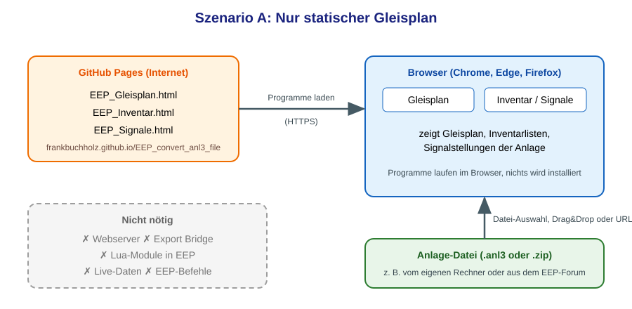
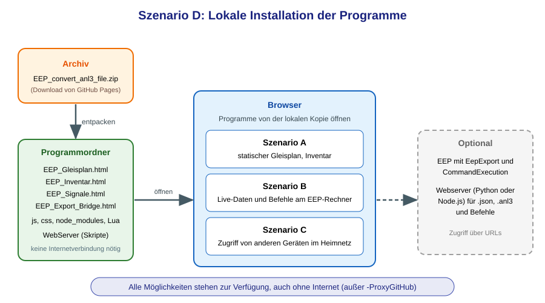

# Projekt: EEP_convert_anl3_file

Dieses Projekt enthält Programme zur Analyse, Darstellung und Konvertierung von Gleisplänen von EEP sowie zur Live-Anzeige und Bedienung einer laufenden EEP-Anlage im Browser.

| Programm | Zweck | Dokumentation |
| --- | --- | --- |
| [`EEP_Gleisplan.html`](EEP_Gleisplan.html "EEP_Gleisplan.html") | Gleisplan einer Anlage im Browser, optional mit Live-Daten und Bedienung | dieser Text |
| [`EEP_Inventar.html`](EEP_Inventar.html "EEP_Inventar.html") | Inventarlisten einer Anlage | dieser Text |
| [`EEP_Signale.html`](EEP_Signale.html "EEP_Signale.html") | Signalstellungen | dieser Text |
| [`EEP_Export_Bridge.html`](EEP_Export_Bridge.html "EEP_Export_Bridge.html") + [`EepExport.lua`](Lua/EepExport.lua "EepExport.lua") + `CommandExecution.lua` | Live-Zustand einer laufenden Anlage (Züge, Signale, Weichen, Zeit, Wetter), optional mit Befehlen an EEP | [`README_Export_Bridge`](https://frankbuchholz.github.io/EEP_convert_anl3_file/README_Export_Bridge.html "README_Export_Bridge") |
| Webserver-Skripte (Python, Node.js, IIS) | liefern `exchange\eep_export.json` und `.anl3` aus und nehmen Befehle für EEP an | [`README_WebServer`](https://frankbuchholz.github.io/EEP_convert_anl3_file/WebServer/README_WebServer.html "README_WebServer") |
| Zertifikat für andere Geräte | macht den Webserver auf Laptop, Tablet und Smartphone vertrauenswürdig | [`README_Zertifikatsverteilung_Heimnetzwerk`](https://frankbuchholz.github.io/EEP_convert_anl3_file/WebServer/README_Zertifikatsverteilung_Heimnetzwerk.html "README_Zertifikatsverteilung_Heimnetzwerk") |

**Aufbau der Dokumentation:** Jede README-Datei hat zwei Teile. **Teil 1 (Benutzer-Dokumentation)** erklärt, was man tun muss. **Teil 2 (Technische Details)** beschreibt, wie es funktioniert, und ist für Entwickler und für die Fehlersuche gedacht. Wer nur anwenden will, liest nur Teil 1.

---

# Teil 1: Benutzer-Dokumentation

## 1. Welches Szenario passt zu mir?

Die Programme laufen im Browser (Chrome, Edge oder Firefox). Je nachdem, was du brauchst, ist mehr oder weniger Einrichtung nötig. Es gibt vier empfohlene Szenarien:

| Szenario | Was bekomme ich? | Was brauche ich zusätzlich? |
| --- | --- | --- |
| **A** Nur statischer Gleisplan | Gleisplan, Inventar und Signalstellungen einer `.anl3`-Datei | nichts, nur einen Browser |
| **B** Live-Daten und EEP-Befehle auf dem Rechner mit EEP | Züge, Signale und Weichen live im Gleisplan, Bedienung von EEP aus dem Browser | Lua-Module `EepExport` und `CommandExecution` in der Anlage, Webserver (Python oder Node.js) |
| **C** Live-Daten und EEP-Befehle auf einem anderen Rechner im Heimnetz | wie B, aber auf Laptop, Tablet oder Smartphone | wie B, zusätzlich Firewall-Freigabe und Zertifikat auf dem anderen Gerät |
| **D** Lokale Installation der Programme | alle Möglichkeiten von A bis C, auch ohne Internet | Archiv entpacken, dazu je nach Wunsch wie bei B und C |

### Szenario A: Nur statischer Gleisplan

Du rufst die Programme über die GitHub-Links auf und lädst eine Anlage-Datei. Es gibt keinen Webserver, keine Bridge, keine Live-Daten und keine EEP-Befehle.

1. Programm im Browser öffnen: [Gleisplan](https://frankbuchholz.github.io/EEP_convert_anl3_file/EEP_Gleisplan.html "EEP_Gleisplan.html"), [Inventar](https://frankbuchholz.github.io/EEP_convert_anl3_file/EEP_Inventar.html "EEP_Inventar.html") oder [Signale](https://frankbuchholz.github.io/EEP_convert_anl3_file/EEP_Signale.html "EEP_Signale.html").
2. Anlage-Datei (`.anl3` oder `.zip`) per Datei-Auswahl, Drag&Drop oder URL laden.
3. Bedienung siehe Abschnitte 2 bis 4.

### Szenario B: Live-Daten und EEP-Befehle auf dem Rechner mit EEP

EEP, Webserver und Browser laufen auf demselben Rechner. Die Anlage schreibt mit `EepExport.lua` ihren Zustand in eine JSON-Datei und liest mit `CommandExecution.lua` die Befehle, die der Webserver entgegennimmt. Bridge und Gleisplan zeigen den Zustand live und können Signale, Weichen und Züge bedienen.

1. **Lua-Module in die Anlage einbinden** (`EepExport` und `CommandExecution`): [`README_Export_Bridge`](https://frankbuchholz.github.io/EEP_convert_anl3_file/README_Export_Bridge.html#1-lua-module-in-eine-anlage-einbinden "README_Export_Bridge"), Abschnitt 1.
2. **Webserver installieren** (Python oder Node.js, mit `-ActivateCommands`): [`README_WebServer`](https://frankbuchholz.github.io/EEP_convert_anl3_file/WebServer/README_WebServer.html "README_WebServer"), Abschnitt 4.
3. **Bridge und Gleisplan öffnen**, entweder über die GitHub-Links oder über den Webserver (Option `-ProxyGitHub`), und die Daten per URL laden: [`README_Export_Bridge`](https://frankbuchholz.github.io/EEP_convert_anl3_file/README_Export_Bridge.html "README_Export_Bridge"), Abschnitte 3 bis 5.

### Szenario C: Live-Daten und EEP-Befehle auf einem anderen Rechner im Heimnetz

EEP läuft auf einem Rechner, der Browser auf einem anderen Gerät im Heimnetz (zweiter PC, Tablet, Smartphone). Der Webserver auf dem EEP-Rechner liefert dem Browser sowohl die Programme (Bridge, Gleisplan) als auch die Dateien `eep_export.json` und `.anl3` und nimmt die Befehle entgegen.

1. Lua-Module einbinden wie bei Szenario B.
2. Webserver auf dem EEP-Rechner installieren, mit `-ActivateCommands`, `-OpenFirewall` und `-ProxyGitHub`.
3. Die erzeugte `.cer`-Datei auf dem anderen Gerät importieren: [`README_Zertifikatsverteilung_Heimnetzwerk`](https://frankbuchholz.github.io/EEP_convert_anl3_file/WebServer/README_Zertifikatsverteilung_Heimnetzwerk.html "README_Zertifikatsverteilung_Heimnetzwerk").
4. Auf dem anderen Gerät Bridge und Gleisplan **über den Webserver** aufrufen, z. B. `https://192.168.0.115:3001/EEP_Export_Bridge?url=/exchange/eep_export.json`.

### Szenario D: Lokale Installation der Programme

Das Archiv [`EEP_convert_anl3_file.zip`](https://frankbuchholz.github.io/EEP_convert_anl3_file/dist/EEP_convert_anl3_file.zip "EEP_convert_anl3_file.zip") wird in einem beliebigen Ordner entpackt. Die Programme laufen dann ohne Internetverbindung. Alle Möglichkeiten der Szenarien A bis C stehen zur Verfügung:

- **Statischer Gleisplan (A):** HTML-Datei im Browser öffnen und die Anlage laden.
- **Live-Daten und Befehle (B, C):** Webserver und Lua-Module wie dort beschrieben einrichten. Die Seiten kommen dann aus der lokalen Kopie. Ohne Befehle kann die Bridge die JSON-Datei auch direkt lesen (*Datei live verfolgen*, Chrome oder Edge).
- Bridge und Gleisplan müssen aus demselben Ursprung geöffnet werden, um miteinander zu sprechen. Das Öffnen als `file://` verhält sich je nach Browser unterschiedlich; Einzelheiten und Alternativen stehen in [`README_Export_Bridge`](https://frankbuchholz.github.io/EEP_convert_anl3_file/README_Export_Bridge.html "README_Export_Bridge"), Abschnitt 3.
- Nur die Webserver-Option `-ProxyGitHub` braucht Internet, weil sie die Seiten von GitHub holt.

## 2. Programm: EEP_Gleisplan.html

Der Gleisplan zu einer EEP-Anlage wird im Browser angezeigt. Solche EEP-Anlagen findest du z. B. hier:
[https://www.eepforum.de/filebase/category-file-list/39-kostenlose-anlagen-ab-eep-7/](https://www.eepforum.de/filebase/category-file-list/39-kostenlose-anlagen-ab-eep-7/ "Kostenlose Anlagen ab EEP 7")

**Aufruf:** [https://frankbuchholz.github.io/EEP_convert_anl3_file/EEP_Gleisplan.html](https://frankbuchholz.github.io/EEP_convert_anl3_file/EEP_Gleisplan.html "EEP_Gleisplan.html")

### Anlage laden

Die Anlage-Datei (`.anl3` oder `.zip`) lässt sich per Datei-Auswahl, Drag&Drop oder URL laden (Eingabefeld **URL laden** bzw. Aufruf mit `EEP_Gleisplan.html?url=<Adresse der .anl3- oder .zip-Datei>`). Schlägt das Laden einer URL fehl, erscheint eine rote Meldung mit der wahrscheinlichen Ursache.

**Zip-Dateien:** Anlage-Dateien werden oft als `.zip` angeboten. Du kannst die `.zip`-Datei direkt angeben, ein vorheriges Entpacken ist nicht nötig. Das Archiv muss genau eine `.anl3`-Datei enthalten (oben oder in einem Verzeichnis), sonst erscheint eine Fehlermeldung. Der Name der enthaltenen `.anl3`-Datei wird angezeigt und beim Bildexport verwendet. Verschlüsselte Archive und zip64 (über 4 GB) werden nicht unterstützt.

### Mausfunktionen

Verschieben: Klick+Halten+Bewegen  
An der Stelle des Cursors hineinzoomen: Doppelklick  
Herauszoomen: <kbd>&#x21E7; Shift</kbd>+Doppelklick  
Details anzeigen: Klick auf Gleis, Symbol, Text oder (bei Live-Anzeige) Zug

- wenn zusammen mit <kbd>&#x21E7; Shift</kbd>, dann wird jeweils ein neues Popup geöffnet
- wenn zusammen mit <kbd>alt</kbd>, dann wird zusätzlich der Code aus der Anlage-Datei für dieses Objekt angezeigt (bei Zügen: die Liste der Fahrzeuge)

### Tastaturfunktionen

<kbd>&larr;</kbd> <kbd>&uarr;</kbd> <kbd>&rarr;</kbd> <kbd>&darr;</kbd> : Verschieben der Graphik (wenn zusammen mit <kbd>&#x21E7; Shift</kbd>, dann jeweils um eine halbe Seite)  
<kbd>+</kbd> <kbd>-</kbd> : Zoomen

### Touch-Bedienung (Tablet, Smartphone)

Ein Finger verschiebt, zwei Finger zoomen. Der Kopfbereich lässt sich mit dem Pfeil-Knopf links oben ein- und ausklappen, um mehr Platz für den Plan zu haben. Langdruck auf ein Signal, eine Weiche, einen Zug oder eine Kamera öffnet (bei aktiven EEP-Befehlen) ein Kontextmenü.

### Interaktive Funktionen

- Wechsel zwischen vertikaler und horizontaler Ausrichtung (Fullscreen mit <kbd>F11</kbd>), Zoom-in, -out, -reset
- Auswahl der anzuzeigenden Gleissysteme und von Informationen wie Texten oder Markern
- Überlappende Texte von Signalen, Weichen und Kontakten werden automatisch entzerrt (abschaltbar mit der Checkbox *Texte entzerren*)
- Aktuelle Darstellung als Bild (`.png`/`.jpg`/`.svg`) speichern
- Gleisplan auf ein bestimmtes Gleis, ein Signal oder eine Weiche positionieren (auch über das Inventar-Programm möglich)
- Einstellung der Linienbreite und der Schriftgröße, Höhenfilter (minimale und maximale Höhe), Farben der Gleissysteme anpassen
- Anzeige der Fahrstraßen (alle bzw. von bestimmten Start-Signalen oder zu bestimmten Ende-Signalen)
- **Live-Anzeige** von Zügen sowie Signal- und Weichenstellungen einer laufenden EEP-Anlage mit Infobox zu Zügen und Fahrzeugen (Szenarien B bis D, siehe [`README_Export_Bridge`](https://frankbuchholz.github.io/EEP_convert_anl3_file/README_Export_Bridge.html "README_Export_Bridge"))
- **Befehle an EEP** (optional): Signale und Weichen stellen, Geschwindigkeit und Route von Zügen setzen, Kameras und Verfolgerkamera aufrufen, über die Infobox oder ein Kontextmenü (<kbd>Strg</kbd>+Klick, Rechtsklick, Langdruck auf dem Tablet)

### Tipp zum Export als svg

Die Export-Funktion im Programm exportiert den gezeigten Ausschnitt der svg-Graphik. Die gesamte Graphik exportierst du mit dem Entwickler-Tool des Browsers:

- Google Chrome: Rechts-Klick in der Graphik &rarr; Inspect <kbd>Ctrl+Shift+I</kbd> &rarr; Das svg-Element wird blau hinterlegt angezeigt &rarr; Rechts-Klick darauf &rarr; Copy &rarr; Copy Element
- Firefox: Rechts-Klick in der Graphik &rarr; Element untersuchen &rarr; Das svg-Element wird blau hinterlegt angezeigt &rarr; Rechts-Klick darauf &rarr; Kopieren &rarr; Äußeres HTML

Das svg-Element aus der Zwischenablage kannst du in ein leeres Textdokument einfügen und als `.svg`-Datei speichern.

### Referenz

Diskussionsbeitrag im [EEP-Forum](https://www.eepforum.de/forum/thread/26770-eep-gleisplan-im-browser-anzeigen-javascript-projekt).

## 3. Programm: EEP_Inventar.html

Anzeige einer Inventarliste zu einer EEP-Anlage.

**Aufruf:** [https://frankbuchholz.github.io/EEP_convert_anl3_file/EEP_Inventar.html](https://frankbuchholz.github.io/EEP_convert_anl3_file/EEP_Inventar.html "EEP_Inventar.html")

Ausgegeben werden Listen der Weichen, Signale, Kontakte, virtuellen Verbindungen, Zugverbände, Depots, Rollmaterialien, Gleisstile, Gleisobjekte und Kameras sowie die Gleisbildstellpulte. Die Anlage-Datei (`.anl3` oder `.zip` mit genau einer `.anl3`-Datei, siehe *Zip-Dateien*) lädst du per Datei-Auswahl, Drag&Drop oder URL (Eingabefeld **URL laden** bzw. Aufruf mit `EEP_Inventar.html?url=<Adresse der .anl3- oder .zip-Datei>`).

### Interaktive Funktionen

Man kann die Tabellen (bei Firefox auch mit Strg+A) mit Copy & Paste in ein Tabellenverarbeitungsprogramm übertragen. Dazu schaltet man am besten zuvor die Anzeige der Filter-Zeile aus. Die Tabellen lassen sich mit Klicks in die Spaltenüberschriften sortieren.

[Filter-Operatoren](https://github.com/koalyptus/TableFilter/wiki/4.-Filter-operators):  
<kbd>&lt;</kbd>, <kbd>&lt;=</kbd>, <kbd>=</kbd>, <kbd>&gt;=</kbd>, <kbd>&gt;</kbd>, <kbd>*</kbd>, <kbd>!</kbd> (nicht), <kbd>{</kbd> (beginnt mit), <kbd>}</kbd> (endet mit), <kbd>||</kbd> (oder), <kbd>&amp;&amp;</kbd> (und), <kbd>[empty]</kbd>, <kbd>[nonempty]</kbd>, <kbd>rgx:</kbd> (gefolgt von einer _regular expression_)

Öffnest du in einem weiteren Fenster oder Tab den Gleisplan für dieselbe Anlage-Datei, positionieren die Links von Gleisen, Signalen, Weichen oder Kontakten den Gleisplan auf das gewählte Objekt und öffnen dort das Info-Popup:

- wenn zusammen mit <kbd>&#x21E7; Shift</kbd>, dann wird jeweils ein neues Popup geöffnet
- wenn zusammen mit <kbd>alt</kbd>, dann wird zusätzlich der Code aus der Anlage-Datei für dieses Objekt angezeigt

## 4. Programm: EEP_Signale.html

Anzeige von Signalpositionen.

**Aufruf:** [https://frankbuchholz.github.io/EEP_convert_anl3_file/EEP_Signale.html](https://frankbuchholz.github.io/EEP_convert_anl3_file/EEP_Signale.html "EEP_Signale.html")

Die Bedeutung der Signalstellung hängt vom jeweiligen Modell ab, es gibt keine Standards, nicht einmal für die ersten beiden Stellungen. Es gibt etliche Signale mit der Kombination { 1 : Fahrt, 2 : Halt }, einige mit { 1 : Halt, 2 : Fahrt } und etliche weitere Kombinationen, die mit { 1 : Halt, … } beginnen. Die Ausgabe erfolgt gruppiert nach der Stellungskombination; je Kombination wird eine eindeutige ID erzeugt.

## 5. Programm: EEP_Export_Bridge.html

Die Bridge zeigt den aktuellen Zustand einer laufenden EEP-Anlage (Züge, Rollmaterial, Signale, Weichen, Zeit, Wetter), leitet ihn an den Gleisplan weiter und kann optional Befehle an EEP senden.

**Aufruf:** [https://frankbuchholz.github.io/EEP_convert_anl3_file/EEP_Export_Bridge.html](https://frankbuchholz.github.io/EEP_convert_anl3_file/EEP_Export_Bridge.html "EEP_Export_Bridge.html")

Mit URL-Parameter startet die Abfrage sofort: `EEP_Export_Bridge.html?url=<Adresse der eep_export.json>`.

Einrichtung, Bedienung und Fehlersuche stehen in [`README_Export_Bridge`](https://frankbuchholz.github.io/EEP_convert_anl3_file/README_Export_Bridge.html "README_Export_Bridge"). Den Webserver beschreibt [`README_WebServer`](https://frankbuchholz.github.io/EEP_convert_anl3_file/WebServer/README_WebServer.html "README_WebServer").

---

# Teil 2: Technische Details

## 6. Technik des Gleisplans

- **Parsen:** Die `.anl3`-Datei besteht aus [XML](https://www.w3schools.com/xml/xml_tree.asp). Sie wird mit der Javascript-Funktion [`DOMParser`](https://www.w3schools.com/xml/xml_parser.asp) in das [Document Object Model (DOM)](https://www.w3schools.com/xml/xml_dom.asp) umgewandelt.
- **Grafik:** Dynamisch mit Javascript wird die Graphik mit [SVG](https://www.w3schools.com/html/html5_svg.asp)-Befehlen aufgebaut. Die Formatierung erfolgt getrennt von der Definition der Graphik mit der SVG-Variante von [CSS](https://www.w3schools.com/html/html_css.asp).
- **Pan und Zoom, Popups:** [`svg-pan-zoom`](https://github.com/bumbu/svg-pan-zoom) zum Verschieben und Zoomen, [`toolwindow`](https://github.com/fluffynuts/toolwindow) für Popups.
- **Layout:** Die Größenanpassung des SVG-Elements an den restlichen Bildschirmbereich erfolgt mit [`flex`](https://www.w3schools.com/css/css3_flexbox.asp).
- **Einstellungen:** Werden automatisch mit [`localStorage`](https://www.w3schools.com/html/html5_webstorage.asp) gespeichert.
- **Fortschrittsbalken:** Beim Laden großer Dateien über `Promise` / `requestAnimationFrame` und mehrere Verarbeitungsschritte. Der Internet Explorer unterstützt diese und andere moderne Sprachkonstrukte nicht. Empfohlen sind aktuelle Versionen von Chrome, MS Edge (beide Chromium-basiert) und Firefox.
- **Linien- und Textbreite:** Dynamische Anpassung der CSS-Variablen in den SVG-CSS-Regeln.
- **Höhenfilter:** Der doppelte Schieberegler basiert auf [multirange](https://leaverou.github.io/multirange/). Der Filter wird über die dynamische Anpassung der CSS-Klassen von SVG-Gruppenelementen realisiert.
- **Laden per URL:** Mit `fetch`. Bei einer URL auf einem anderen Server muss dieser CORS-Zugriffe erlauben; `file://` funktioniert nicht. Für Fehlerfälle (HTTP-Status, fehlende Verbindung, CORS, Mixed Content) wird die wahrscheinliche Ursache angezeigt.
- **Zip-Dateien:** Ob eine Datei ein zip-Archiv ist, wird am Inhalt erkannt, nicht am Dateinamen (daher funktionieren auch URLs ohne Endung `.zip`). Das Entpacken erfolgt im Browser mit `DecompressionStream`, eine zusätzliche Bibliothek wird nicht benötigt.
- **Zusammenspiel der Programme:** Die Interaktion mit dem Inventar-Programm und der Export Bridge erfolgt über [`BroadcastChannel`](https://developer.mozilla.org/de/docs/Web/API/BroadcastChannel) (Kanäle `EEP` und `EEP_LIVE`, siehe [`README_Export_Bridge`](https://frankbuchholz.github.io/EEP_convert_anl3_file/README_Export_Bridge.html "README_Export_Bridge"), Abschnitt 9).
- **Modulstruktur der js-Dateien:** `EEP_Gleisplan_LoadFile.js` (Laden), `EEP_Gleisplan_Data.js` (Aufbereitung der Daten ohne SVG), `EEP_Gleisplan_Geometry.js` (reine Geometrie), `EEP_Gleisplan_DOM2SVG.js` (SVG-Elemente), `EEP_Gleisplan_LabelLayout.js` (Textentzerrung), `EEP_Gleisplan_MainScreen.js`, `EEP_Gleisplan_SgvPanZoom.js`, `EEP_Gleisplan_InfoPopup.js` und `EEP_Gleisplan_LiveData.js` (Live-Erweiterung).
- In 2026 wurden mit Hilfe der Claude AI mehrere Korrekturen und Performance-Verbesserungen erarbeitet. Anschließend wurde mit dieser AI die Anzeige von Live-Daten und die EEP-Befehlsverarbeitung sowie die Dokumentation gebaut.

## 7. Technik des Inventars

- Die `.anl3`-Datei wird wie im Gleisplan mit [`DOMParser`](https://www.w3schools.com/xml/xml_parser.asp) in das DOM umgewandelt, der Inhalt wird in Tabellen ausgegeben.
- Die interaktiven Funktionen der Tabellen (Filter, Spaltenverwaltung) stammen aus der Bibliothek [`TableFilter`](https://github.com/koalyptus/TableFilter). Sortieren nach Klick auf die Spaltenüberschrift ist selbst implementiert.
- Die Interaktion mit dem Gleisplan erfolgt über [`BroadcastChannel`](https://developer.mozilla.org/de/docs/Web/API/BroadcastChannel) (Kanal `EEP`, Nachrichten `showTrack`, `showID`, `showContact`, `showCamera`, `showTrackObject`, `showGBS`).

## 8. Abhängigkeiten

Das Projekt verwendet die GitHub-Bibliotheken [`svg-pan-zoom`](https://github.com/bumbu/svg-pan-zoom), [`toolwindow`](https://github.com/fluffynuts/toolwindow) und [`TableFilter`](https://github.com/koalyptus/TableFilter) sowie `multirange` für den Höhenfilter.

---

# Impressum

(c) Frank Buchholz, 2019
