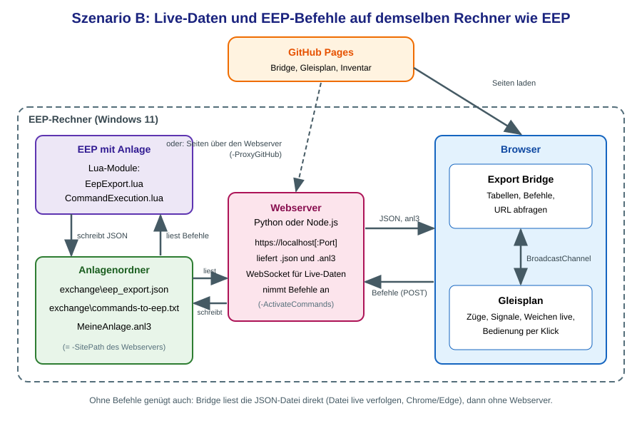
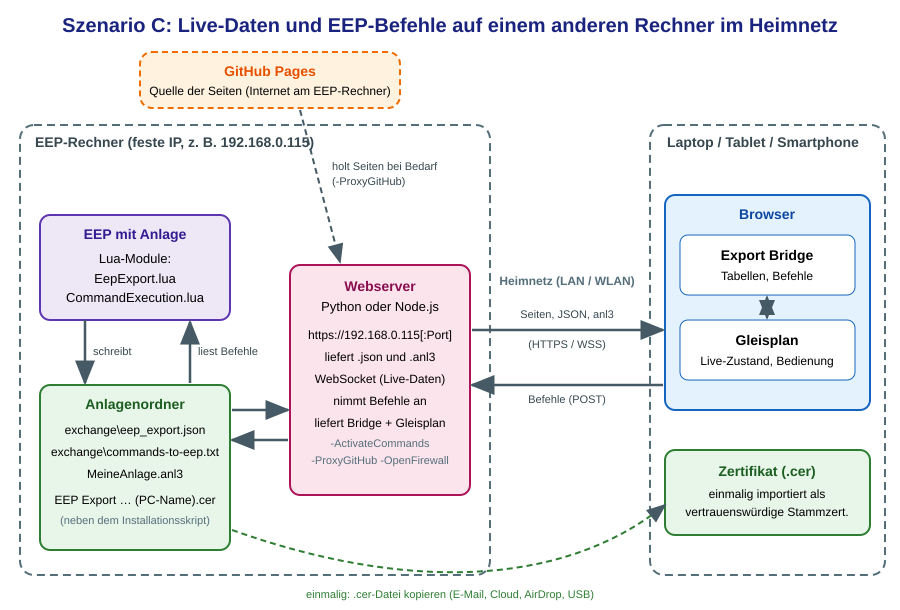

# EEP Export Bridge und Live-Gleisplan

Mit diesem Programm siehst du den aktuellen Zustand einer laufenden EEP-Anlage im Browser: Züge, Signal- und Weichenstellungen, Uhrzeit und Wetter. Optional bedienst du die Anlage auch aus dem Browser (Signale und Weichen stellen, Zügen Geschwindigkeit und Route geben, Kameras aufrufen).

| Baustein | Aufgabe |
| --- | --- |
| **[`EepExport.lua`](Lua/EepExport.lua "EepExport.lua")** (in EEP) | schreibt den aktuellen Anlagenzustand in die Datei `exchange\eep_export.json` |
| **`CommandExecution.lua`** (in EEP) | liest die Befehle aus `exchange\commands-to-eep.txt` und führt sie in EEP aus (nur für Befehle nötig) |
| **[`EEP_Export_Bridge.html`](EEP_Export_Bridge.html "EEP_Export_Bridge.html")** | liest die JSON-Datei, zeigt Züge, Signale, Weichen und Rollmaterial als Tabellen, leitet die Daten an den Gleisplan weiter und sendet optional Befehle an EEP |
| **[`EEP_Gleisplan.html`](EEP_Gleisplan.html "EEP_Gleisplan.html")** | zeigt den Gleisplan einer Anlage (`.anl3`) und zeichnet die Live-Daten der Bridge hinein; optional bedienst du Signale, Weichen, Züge und Kameras direkt im Plan |
| **Webserver** (Python oder Node.js, siehe [`README_WebServer`](https://frankbuchholz.github.io/EEP_convert_anl3_file/WebServer/README_WebServer.html "README_WebServer")) | liefert `eep_export.json` und die `.anl3`-Datei aus, sendet Änderungen sofort per WebSocket und nimmt Befehle für EEP an |

```
EEP (EepExport.lua) ──► Datei eep_export.json ──► Webserver ──► EEP_Export_Bridge.html ──► EEP_Gleisplan.html
                        Datei <Anlage>.anl3   ──► Webserver ────────────────────────────► (Züge, Signale, Weichen im Plan)

Befehle (optional):
EEP_Gleisplan.html ──► EEP_Export_Bridge.html ──► POST /send-command ──► Webserver ──► exchange\commands-to-eep.txt ──► CommandExecution.lua in EEP
```

**Aufbau dieser Datei:** Teil 1 ist die Benutzer-Dokumentation (einrichten, bedienen, Fehler beheben). Teil 2 enthält die technischen Details (Konfiguration des Lua-Moduls, Kommunikationsprotokolle, JSON-Format).

## Inhalt

**Teil 1: Benutzer-Dokumentation**

- [1. Lua-Module in eine Anlage einbinden](#1-lua-module-in-eine-anlage-einbinden)
- [2. Welcher Weg passt zu mir?](#2-welcher-weg-passt-zu-mir)
- [3. Bridge und Gleisplan verbinden](#3-bridge-und-gleisplan-verbinden)
- [4. Die Export Bridge bedienen](#4-die-export-bridge-bedienen)
- [5. Der Gleisplan mit Live-Daten](#5-der-gleisplan-mit-live-daten)
- [6. Befehle an EEP senden](#6-befehle-an-eep-senden)
- [7. Fehlersuche](#7-fehlersuche)

**Teil 2: Technische Details**

- [8. EepExport.lua im Detail](#8-eepexportlua-im-detail)
- [9. Kommunikation zwischen den Programmen](#9-kommunikation-zwischen-den-programmen)
- [10. Aufbau der JSON-Datei](#10-aufbau-der-json-datei)
- [11. Geplante Änderungen](#11-geplante-änderungen)

---

# Teil 1: Benutzer-Dokumentation

## 1. Lua-Module in eine Anlage einbinden

Damit die Anlage ihren Zustand ausgibt und Befehle entgegennimmt, brauchen die Anlage zwei Lua-Module:

- **`EepExport`** schreibt den Zustand nach `exchange\eep_export.json`. Es ist für Live-Daten nötig.
- **`CommandExecution`** liest `exchange\commands-to-eep.txt` und führt die Befehle aus. Es ist nur nötig, wenn du EEP aus dem Browser bedienen willst.

**Minimalversion von `EepExport`:**

1. **Modul ablegen.** Kopiere `EepExport.lua` in den Lua-Ordner von EEP. Ab EEP 18.1 Plugin 1 kannst du sie auch in den Anlagenordner neben die `.anl3`-Datei legen.
2. **Hauptskript ergänzen.** Öffne in EEP das Lua-Fenster der Anlage und füge ein:

   ```lua
   local EepExport = require("EepExport")

   function EEPMain()
     EepExport.run()         -- exportiert automatisch im eingestellten Intervall
     return 1
   end
   ```

3. **Anlage starten.** Nach dem Start entsteht die Datei `exchange\eep_export.json` und wird alle 5 EEP-Sekunden aktualisiert. Sie liegt im Anlagenordner (neben der `.anl3`-Datei), sofern EEP ihn ermitteln kann (ab EEP 18.1 Plugin 1). Sonst wird der Ordner des zuletzt gespeicherten Anlagenpfads verwendet (bekannt, sobald die Anlage einmal gespeichert wurde) und zuletzt das Arbeitsverzeichnis, das ist der Installationsordner von EEP.

   **Merke dir den Speicherort.** Du brauchst ihn für den Webserver (`-SitePath`) und beim Dateizugriff.

**`CommandExecution`** wird analog eingebunden: Modul ablegen, im Hauptskript laden und aufrufen. Die genauen Aufrufe stehen im Kopfkommentar der Datei `CommandExecution.lua`. Der Webserver schreibt die Befehle nur in die Datei `exchange\commands-to-eep.txt`, das Modul muss dieselbe Datei lesen.

**Gut zu wissen**

- Signale, Weichen, Depots, Züge und Rollmaterial werden automatisch erkannt. Du musst nichts anmelden.
- Fehler beim Export (z. B. eine nicht beschreibbare Datei) meldet `run()` im EEP-Ereignisfenster. Die letzte Fehlermeldung steht in `EepExport.lastError`.
- Beim Speichern der Anlage pausiert der Export kurz.
- Die häufigsten Einstellungen sind `outputFile` (anderer Ausgabeort), `interval` (Export-Intervall in EEP-Sekunden), `anlFile` (alle Fahrzeuge aus der `.anl3`-Datei einlesen) und `debug`. Alle Einstellungen beschreibt Abschnitt 8.

## 2. Welcher Weg passt zu mir?

Die empfohlenen Szenarien sind in der [`README`](https://frankbuchholz.github.io/EEP_convert_anl3_file/ "README") erklärt. Für diese Datei sind **B** bis **D** wichtig:

| Szenario | Datenzugriff | Webserver | Befehle an EEP |
| --- | --- | --- | --- |
| **B** EEP und Browser auf demselben Rechner | per URL (`https://localhost…`), Seiten von GitHub oder vom Webserver | ja (Python oder Node.js) | ja |
| **C** EEP auf einem Rechner, Browser auf einem anderen Gerät im Heimnetz | per URL (`https://<IP-Adresse>…`), Seiten vom Webserver | ja (Python oder Node.js) | ja |
| **D** lokale Kopie der Programme | wie B und C, zusätzlich Dateizugriff | je nach Wunsch | je nach Wunsch |





**Warum ein Webserver?** Ein Browser darf Dateien eines anderen Rechners nicht direkt lesen, und eine Seite aus dem Web (HTTPS) darf nur HTTPS-Quellen abfragen. Außerdem können nur über den Webserver Befehle an EEP gelangen. Die Skripte in [`README_WebServer`](https://frankbuchholz.github.io/EEP_convert_anl3_file/WebServer/README_WebServer.html "README_WebServer") richten ihn mit wenigen Handgriffen ein.

**Weitere Möglichkeiten (ohne Befehle):** Wer nur Live-Daten sehen will und EEP und Browser auf demselben Rechner nutzt, kann die JSON-Datei auch direkt lesen (Abschnitt 3.2) oder einen einfachen lokalen Server nutzen (Abschnitt 3.3). Befehle an EEP sind dabei nicht möglich.

## 3. Bridge und Gleisplan verbinden

### 3.1 URL-Zugriff über den Webserver (empfohlen)

Voraussetzung: Der Webserver läuft (Szenario B oder C, siehe [`README_WebServer`](https://frankbuchholz.github.io/EEP_convert_anl3_file/WebServer/README_WebServer.html "README_WebServer")). Die Bridge holt die JSON-Datei per HTTPS und wechselt danach automatisch auf WebSocket: Jede Änderung kommt sofort an, die Statuszeile zeigt „WebSocket“ statt „HTTP“.

**Szenario B, Seiten von GitHub:**

```
https://frankbuchholz.github.io/EEP_convert_anl3_file/EEP_Export_Bridge.html?url=https://localhost:3001/exchange/eep_export.json
https://frankbuchholz.github.io/EEP_convert_anl3_file/EEP_Gleisplan.html?url=https://localhost:3001/MeineAnlage.anl3
```

**Szenario B oder C, Seiten vom Webserver** (Webserver mit `-ProxyGitHub` installiert; `192.168.0.115` ersetzt du durch die IP-Adresse oder den Namen des EEP-Rechners, auf dem EEP-Rechner selbst genügt `localhost`):

```
https://192.168.0.115:3001/EEP_Export_Bridge?url=/exchange/eep_export.json
https://192.168.0.115:3001/EEP_Gleisplan?url=/MeineAnlage.anl3
```

Auf einem anderen Gerät muss vorher das Zertifikat importiert sein, siehe [`README_Zertifikatsverteilung_Heimnetzwerk`](https://frankbuchholz.github.io/EEP_convert_anl3_file/WebServer/README_Zertifikatsverteilung_Heimnetzwerk.html "README_Zertifikatsverteilung_Heimnetzwerk"). Ohne `?url=…` trägst du die Adresse im Feld **URL** ein und klickst auf **URL abfragen**.

**Ablauf**

1. **EEP starten** und die Anlage mit den Lua-Modulen laufen lassen (Abschnitt 1).
2. **Bridge öffnen** und die URL der JSON-Datei abfragen.
3. **Gleisplan öffnen**, über **Gleisplan öffnen** in der Bridge oder direkt über `EEP_Gleisplan.html`.
4. **Die `.anl3`-Datei derselben Anlage laden** (Datei-Auswahl, Drag&Drop oder URL, z. B. `https://192.168.0.115:3001/MeineAnlage.anl3`, oder Aufruf mit `?url=…`). Die Datei wird einmalig geladen, nicht fortlaufend. Wurde die Anlage in EEP geändert und gespeichert, lädst du sie im Gleisplan erneut. Der Gleisplan meldet sich erst nach dem Laden bei der Bridge, ab dann fließen die Daten.
5. Sobald sich die Daten ändern, aktualisiert sich der Gleisplan von selbst.

**Wichtig:** Lade im Gleisplan dieselbe Anlage, die in EEP läuft. Bei einer anderen Anlage stimmen Gleis-, Signal- und Weichennummern nicht überein.

**Bridge und Gleisplan müssen aus demselben Ursprung geladen werden** (gleiches Protokoll, gleicher Rechnername, gleicher Port) und im selben Browser (selbes Profil) laufen. Beispiele: beide von GitHub Pages, beide vom Webserver oder beide von derselben lokalen Kopie. Der Knopf **Gleisplan öffnen** der Bridge öffnet den Gleisplan aus demselben Ordner und sorgt so automatisch für denselben Ursprung.

**Zuletzt:** Die Bridge merkt sich die zuletzt benutzte Datei bzw. URL und bietet sie beim nächsten Aufruf als Knopf **Zuletzt: …** an.

### 3.2 Direkter Dateizugriff (nur Live-Daten, keine Befehle)

Wenn EEP und Browser auf **demselben Rechner** laufen, kann die Bridge die JSON-Datei ohne Webserver lesen:

1. `EEP_Export_Bridge.html` im Browser öffnen.
2. Auf **Datei öffnen** (englisch *Open file*) klicken und die Datei `exchange\eep_export.json` wählen.
3. Bei **alle … s** das Abfrageintervall einstellen (Standard: 2 Sekunden).

Die Bridge liest die Datei nun in diesem Takt neu. Der Browser fragt nur einmal nach der Erlaubnis. Zusätzlich lässt sich eine Datei per Drag&Drop laden. Wer keine Updates will, pausiert EEP oder arbeitet mit einer Kopie der Datei.

> **Einschränkung:** Das fortlaufende Lesen funktioniert nur in Chrome und Edge auf einem PC oder Laptop, nicht in Firefox und Safari und nicht auf einem Tablet. In diesen Browsern lädt der Knopf die Datei nur einmal. Dort hilft der URL-Zugriff.
> Befehle an EEP und WebSocket gibt es beim Dateizugriff nicht, die Bedienelemente erscheinen nicht. Der Gleisplan lädt seine `.anl3`-Datei per Dateiauswahl oder Drag&Drop.

### 3.3 Einfacher lokaler Server (nur Live-Daten, keine Befehle)

Läuft alles auf einem Rechner und möchtest du den URL-Zugriff nutzen (z. B. in Firefox), reicht ein einfacher lokaler Server. Er liefert Bridge, Gleisplan, JSON-Datei und `.anl3`-Datei **aus einem gemeinsamen Ordner** aus. Lege dazu die Dateien in den entpackten Projektordner (Szenario D) oder starte den Server in einem gemeinsamen übergeordneten Ordner. Die JSON-Datei liegt standardmäßig im Anlagenordner; der Serverordner muss ihn enthalten, oder du setzt `outputFile` auf einen Pfad innerhalb des Serverordners.

```bash
# Windows
py -m http.server 8000 --bind 127.0.0.1

# Linux / macOS
python3 -m http.server 8000 --bind 127.0.0.1

# Node.js
npx http-server -p 8000 -c-1 -a 127.0.0.1 --cors
```

Danach `http://localhost:8000/EEP_Export_Bridge.html?url=exchange/eep_export.json` öffnen. Beenden mit `Strg+C`. Diese Server liefern **alle** Dateien des Ordners aus: Gib sie nie ins Netzwerk oder Internet frei. Dafür sind die Webserver-Skripte gedacht.

### 3.4 Szenario D: lokale Kopie der Programme

Bei einer lokalen Kopie (entpacktes Archiv) kannst du die Seiten per Doppelklick als `file://` öffnen. Dann gilt:

- Der **statische Gleisplan** funktioniert uneingeschränkt, die `.anl3`-Datei lädst du per Dateiauswahl oder Drag&Drop.
- **Bridge und Gleisplan müssen miteinander sprechen können.** Lokale Dateien (`file://`) verhalten sich je nach Browser unterschiedlich; zuverlässiger ist es, beide Seiten von einem lokalen Server (Abschnitt 3.3) oder vom Webserver zu laden.
- Für **Befehle** brauchst du den Webserver. Eine Bridge, die als lokale Datei geöffnet wurde, sendet die Origin `null`; der Webserver lässt sie nur mit der Option `-AllowNullOrigin` zu (Sicherheitshinweise in [`README_WebServer`](https://frankbuchholz.github.io/EEP_convert_anl3_file/WebServer/README_WebServer.html "README_WebServer"), Abschnitt 5).

## 4. Die Export Bridge bedienen

Die Bridge ist eine einzelne HTML-Datei (`EEP_Export_Bridge.html`, zusammen mit `js/EEP_Texts.js` und `css/EEP_Texts.css`). Sie braucht keine Installation. Oben rechts wählst du die Sprache (Deutsch, English, Français). Die Sprachauswahl gilt auch für Gleisplan und Inventar.

**Kopfzeile**

| Element | Funktion |
| --- | --- |
| **Zuletzt: …** | letzte Quelle (Datei oder URL) erneut verwenden |
| **Datei öffnen** | JSON-Datei auswählen und fortlaufend lesen (Abschnitt 3.2) |
| **URL / URL abfragen** | JSON-Datei per HTTP(S) abfragen (auch per Aufruf mit `?url=…`) |
| **alle … s** | Abfrageintervall (gilt für Datei und HTTP(S)-Abfrage, nicht bei aktivem WebSocket) |
| **an Gleisplan senden** | Daten an einen geöffneten Gleisplan weiterleiten |
| **Gleisplan öffnen** | öffnet `EEP_Gleisplan.html` im selben Ordner in einem neuen Fenster |
| **⚡ Befehle an EEP aktiv** | erscheint nur, wenn der Webserver Befehle annimmt; zeigt kurz auch das Ergebnis des letzten Befehls |
| **Befehlszeile** + **Senden** | beliebigen Textbefehl an EEP senden (nur bei aktiven Befehlen, siehe Abschnitt 6) |
| Statuszeile | EEP-Zeit des Exports, Zeit seit der letzten Änderung und Übertragungsweg (HTTP oder WebSocket) |

Die Statuszeile zeigt, ob noch neue Daten ankommen. Wächst die Zeit seit der letzten Änderung dauernd an, steht EEP oder der Export.

**Bereiche**

- **Zeit & Wetter:** EEP-Uhrzeit, EEP-Version, Wolken, Nebel, Regen, Schnee, Hagel, Wind und aktiver Zug.
- **Züge:** Geschwindigkeit, Soll-Geschwindigkeit, Anzahl Fahrzeuge, Länge, Route und Gleis. Bei aktiven Befehlen sind **Soll** und **Route** Eingabefelder.
  - **Folgen:** Mit der Auswahl oben rechts im Bereich zentriert der Gleisplan bei jeder Aktualisierung auf den gewählten Zug.
  - **Zeige:** zentriert den Gleisplan einmalig auf den Zug.
  - **Gleis-Info:** öffnet im Gleisplan die Informationen des Gleises, auf dem der Zug steht.
- **Signale:** Stellung, Tipp-Text und wartende Züge. Die Farben stammen aus dem Gleisplan; ohne verbundenen Gleisplan sind alle Stellungen neutral grau. Bei aktiven Befehlen gibt es eine Spalte **Stellung setzen** mit einem Knopf je Stellung.
- **Weichen:** Stellung (Durchfahrt, Abzweig, KoAbzweig). Bei aktiven Befehlen mit Knöpfen 1 bis 3 zum Stellen.
- **Rollmaterialien:** alle Fahrzeuge mit Zug, Länge, Gleis (mit Richtungspfeil), Position und Kupplungen (vorne/hinten). Fahrzeuge mit Antrieb sind mit „(Lok)“ markiert.

Alle Tabellen haben Filter und Sortierung (wie im Inventar-Programm).

## 5. Der Gleisplan mit Live-Daten

### Was der Gleisplan anzeigt

**Züge:** Der Zug wird als Linienzug entlang des Gleisverlaufs gezeichnet, jedes Fahrzeug als gerade orangefarbene Linie. Die Linien schließen meist lückenlos aneinander an und laufen auch über Gleisgrenzen und Weichen hinweg, aber nicht über virtuelle Verbindungen. Fahrzeuge mit Antrieb (z. B. Loks) sind dunkler und dicker. Ein größerer Kreis markiert die Zugspitze, der Zugname steht darüber. Kleinere Kreise sitzen an den Fahrzeuganfängen; daneben stehen Modelltyp (z. B. „Diesellok“, „Güterwaggon“) und Länge.

**Infobox zu Zügen und Fahrzeugen:** Ein Klick auf einen Zug öffnet eine Infobox mit Geschwindigkeit, Soll-Geschwindigkeit, Länge, Anzahl Fahrzeuge, Route, Position und Gleis (mit Link zur Gleis-Info).

| Bedienung | Wirkung |
| --- | --- |
| Klick | Infobox des Zuges (ersetzt die zuletzt geöffnete Infobox) |
| <kbd>⇧ Shift</kbd> + Klick | öffnet für den Zug eine eigene, zusätzliche Infobox |
| <kbd>Alt</kbd> + Klick | zusätzlich Liste aller Fahrzeuge des Zuges (Modelltyp, Länge, Ausrichtung, Kupplungen, Position, Gleis); das angeklickte Fahrzeug ist fett |
| <kbd>Alt</kbd> + <kbd>⇧ Shift</kbd> + Klick | beides zusammen |

**Signale:** Die Farbe richtet sich nach dem Text der aktuellen Signalstellung aus `js/EEP_Signale_Daten.js`:

| Farbe | Bedeutung |
| --- | --- |
| Rot | Halt |
| Grün | Fahrt |
| Orange | Halt erwarten bzw. Vorsignalstellung |
| Grau | Stellung unbekannt oder nicht eindeutig zuzuordnen |

Das gilt für Haupt-, Vorsignale und Haltepunkte. Bei nicht eindeutigen Stellungstexten (z. B. `Hl 13; Hp 0`) bleibt es bei Grau.

**Weichen:** Der Weichentext (W…) wird nach der Stellung gefärbt: Blau = Durchfahrt, Orange = Abzweig, Lila = KoAbzweig. Andere Stellungen (z. B. 5 = Spezial) bleiben ungefärbt. Die Farben sagen nichts über „frei“ oder „gesperrt“ aus.

**Kameras** erscheinen als Symbole mit Blickrichtung und Sichtfeld (statisch: gefüllter Kreis, dynamisch: Kreisring).

### Zusammenspiel mit der Bridge

- **Folgen:** In der Bridge einen Zug auswählen, der Gleisplan zentriert sich bei jeder Aktualisierung.
- **Zeige** (Züge, Signale, Weichen): zentriert den Gleisplan auf das Objekt. Bei Signalen und Weichen öffnet sich zusätzlich das Info-Fenster des Gleisplans.
- **Gleis-Info:** öffnet das Info-Fenster des Gleises, auf dem der Zug steht.
- **an Gleisplan senden:** Mit abgeschaltetem Häkchen sendet die Bridge keine Daten mehr. Beim erneuten Einschalten wird sofort der aktuelle Stand gesendet.
- **Signalfarben:** Die Bridge fragt die Stellungstexte der Signale beim Gleisplan ab und färbt damit ihre Signaltabelle.
- **Befehle:** Der Gleisplan sendet Befehle über die Bridge an EEP (siehe Abschnitt 6).

### Hinweise und Grenzen

- Die Gleisgeometrie wird aus Anfang, Mitte und Ende jedes Gleises angenähert. In engen Kurven und bei Gleisen mit ungewöhnlichen Kurventypen können Fahrzeuge leicht neben dem Gleis liegen.
- Die Lage der Fahrzeuganfänge im Fahrzeug hängt vom Modell ab; Fahrzeuglinien können deshalb gegenüber den Kreisen etwas verschoben erscheinen.
- Wo sich das Gleisnetz verzweigt, folgt der Linienzug bevorzugt dem Gleis, auf dem Fahrzeuge des Zuges stehen. Sonst gilt die aktuelle Weichenstellung.
- Damit Züge, Signale und Weichen sichtbar sind, müssen die entsprechenden Checkboxen im Gleisplan aktiviert sein (*Gleissysteme*, *Signale*, *Weichen* usw.).

## 6. Befehle an EEP senden

Bridge und Gleisplan können Befehle an EEP zurückschicken: Signale und Weichen stellen, Zügen eine Geschwindigkeit oder Route geben und Kameras aufrufen. Die Bedienelemente erscheinen **nur, wenn der Webserver Befehle annimmt**. Ohne Befehle ändert sich nichts an der Anzeige.

**Voraussetzungen**

1. **Webserver mit Befehlsannahme:** Python oder Node.js, installiert mit `-ActivateCommands` (oder gestartet mit `--activateCommands`). Der IIS unterstützt das nicht (siehe [`README_WebServer`](https://frankbuchholz.github.io/EEP_convert_anl3_file/WebServer/README_WebServer.html "README_WebServer"), Abschnitt 7).
2. **`CommandExecution` in der Anlage** (Abschnitt 1).
3. **URL-Zugriff:** Die Bridge muss die Daten per URL abfragen, bei direktem Dateizugriff gibt es keine Befehle.

Erscheint in der Kopfzeile der Bridge **⚡ Befehle an EEP aktiv**, ist alles bereit.

**Unterstützte Befehle**

| Befehl | Wirkung | Beispiel |
| --- | --- | --- |
| `EEPSetSignal\|ID\|Stellung` | Signal stellen | `EEPSetSignal\|12\|2` |
| `EEPSetSwitch\|ID\|Stellung` | Weiche stellen | `EEPSetSwitch\|7\|3` |
| `EEPSetTrainSpeed\|Zug\|km/h` | Soll-Geschwindigkeit setzen (0 = Halt) | `EEPSetTrainSpeed\|#ICE1\|80` |
| `EEPSetTrainRoute\|Zug\|Route` | Route eines Zuges setzen | `EEPSetTrainRoute\|#ICE1\|Schnellzug` |
| `EEPSetCamera\|Typ\|Name` | Kamera aufrufen (0 statisch, 1 dynamisch, 2 mobil) | `EEPSetCamera\|0\|Stellwerk West` |
| `EEPSetPerspectiveCamera\|Position\|Zug` | Verfolgerkamera auf einen Zug richten | `EEPSetPerspectiveCamera\|7\|#ICE1` |

Zulässige Wertebereiche stehen in Abschnitt 9.3. Perspektiven der Verfolgerkamera: 1 links, 2 rechts, 3 links oben, 4 rechts oben, 5 in Fahrtrichtung, 6 von vorne, 7 automatische Kamera, die dem im Steuerdialog gewählten Zug am nächsten steht, 8 aus dem Führerstand, 9 oberhalb des Zuges. Der Gleisplan verwendet fest **7**.

### Bedienung in der Bridge

| Bereich | Bedienung |
| --- | --- |
| Signale | Spalte **Stellung setzen**: ein Knopf je Stellung, die aktuelle ist hervorgehoben, der Tooltip zeigt den Stellungstext. |
| Weichen | Knöpfe 1 bis 3 (Durchfahrt, Abzweig, KoAbzweig), farblich wie im Gleisplan. |
| Züge | **Soll**: Geschwindigkeit eintragen, mit <kbd>Enter</kbd> oder beim Verlassen des Feldes wird sie gesendet. **Route**: Name der Route eintragen, ebenso. |
| Befehlszeile | Beliebige Zeile eingeben, z. B. `EEPSetSignal\|6\|1`, und **Senden** klicken oder <kbd>Enter</kbd> drücken. <kbd>↑</kbd> / <kbd>↓</kbd> blättern durch die letzten 20 Befehle. |

Die Befehlszeile sendet die Zeile **unverändert** (höchstens 500 Zeichen, keine Steuerzeichen); das Lua-Modul in EEP entscheidet, was sie bedeutet. Sie steht nur in der Bridge zur Verfügung. Nach jedem Befehl zeigt die Kopfzeile kurz „gesendet: …“ bzw. „Befehl nicht gesendet: …“ (Fehler rot). Ein Eingabefeld mit Fokus wird bei neuen Daten nicht überschrieben.

### Bedienung im Gleisplan

**Die Bridge muss dafür geöffnet sein** (im selben Browser), sonst erscheint nach 3 Sekunden „Keine Antwort der Export Bridge (ist sie geöffnet?)“. Ein normaler Klick öffnet weiterhin nur die **Info**, damit nichts versehentlich geschaltet wird. Die Bedienelemente stehen an zwei Stellen:

1. **Im Info-Popup** von Signalen, Weichen, Zügen und Kameras, unter den Angaben zum Objekt.
2. **Als Kontextmenü** mit denselben Bedienelementen:

   | Gerät | Aufruf |
   | --- | --- |
   | PC | <kbd>Strg</kbd> + Klick (Mac: <kbd>Cmd</kbd> + Klick) oder Rechtsklick |
   | Tablet, Smartphone | Langdruck (ca. 0,45 s) auf das Objekt |

   Das Menü schließt sich mit <kbd>Esc</kbd>, nach einem Klick daneben oder nach einem gesendeten Befehl. Verschieben und Zoomen mit dem Finger bricht den Langdruck ab.

| Objekt | Bedienelemente |
| --- | --- |
| Signal | Ein Knopf je Stellung laut `js/EEP_Signale_Daten.js` (höchstens 8), gefärbt nach Bedeutung (rot Halt, grün Fahrt, orange Halt erwarten, grau unbekannt), die aktuelle Stellung ist hervorgehoben |
| Weiche | Knöpfe 1–2, bei 3-Weg-Weichen 1–3, bei Doppelkreuzungsweichen 1–4 |
| Zug | Eingabefeld Geschwindigkeit in km/h (Enter oder Feld verlassen), Knopf **Halt** (Geschwindigkeit 0), Auswahlliste der Routen der Anlage, Knopf **Verfolgerkamera** |
| Kamera | Knopf **Kamera aufrufen**; der Typ (statisch oder dynamisch) stammt aus der Anlage-Datei |

Die Bedienelemente passen sich bei jedem neuen Datensatz an die aktuellen Stellungen an. Ein Eingabefeld oder eine Auswahl mit Fokus bleibt dabei unverändert.

### Sicherheit

- Der Server nimmt Befehle nur über **HTTPS** und nur von erlaubten Origins an (GitHub-Origin, lokales Netz, `localhost`). Wer den Server erreichen darf, kann Befehle für EEP einreichen: Aktiviere die Befehle nur in vertrauenswürdigen Netzen.
- Der Gleisplan sendet nie selbst an den Server, sondern nur über die Bridge und deren Whitelist.
- Die Befehlszeile der Bridge umgeht diese Whitelist. Das Lua-Modul in EEP sollte unbekannte Befehle selbst ablehnen.

## 7. Fehlersuche

| Beobachtung | Mögliche Ursache und Abhilfe |
| --- | --- |
| Es entsteht keine `exchange\eep_export.json` | Prüfe das EEP-Ereignisfenster. Dort meldet `run()` Fehler wie „Datei nicht schreibbar“, mit `debug = true` zusätzlich Details. Die Datei liegt im Anlagenordner (ab EEP 18.1 Plugin 1), sonst im Installationsordner von EEP. Bei älteren EEP-Versionen oder wenn der Pfad nicht beschreibbar ist, `outputFile` setzen. Während die Anlage gespeichert wird, ist der Export pausiert. |
| Züge fehlen in der Datei | Prüfe, ob die Signale gefunden wurden (`discoverMax`) und ob deine Depots im Bereich `1..discoverDepotMax` liegen, sonst `addTrainyards()` verwenden. Ist `installCallbacks = false`, rufe `installCallbacks()` am Ende des Skripts auf. Alternativ mit `addTrains()` anmelden oder `anlFile` setzen (Abschnitt 8). |
| „anl3-Datei …: Datei nicht lesbar“ | Der Pfad in `anlFile` stimmt nicht oder die Datei ist nicht lesbar. Vollständigen Pfad inklusive Dateiname prüfen. Der Export läuft trotzdem weiter. |
| Statuszeile zeigt „keine Daten“ | Quelle noch nicht gewählt. Datei verbinden, URL abfragen oder die Bridge mit `?url=…` aufrufen. |
| „Ungültiges JSON“ | Die Datei wird gerade geschrieben oder ist beschädigt. Beim nächsten Intervall erneut versuchen. |
| „Kein EEP-Export (global/trains fehlen)“ | Falsche Datei gewählt. |
| „HTTP 404“ bei URL | Pfad falsch oder Server im falschen Ordner gestartet. Liegt `exchange\eep_export.json` im `-SitePath` des Webservers? |
| „Fehler: Failed to fetch“ bei URL | Server nicht erreichbar (läuft er? Firewall? IP-Adresse geändert?), Zertifikat auf diesem Gerät nicht vertraut, Origin der Bridge vom Server nicht erlaubt (CORS) oder die Bridge kommt per HTTPS aus dem Web und die URL ist nur HTTP. Siehe [`README_WebServer`](https://frankbuchholz.github.io/EEP_convert_anl3_file/WebServer/README_WebServer.html "README_WebServer"), Abschnitt 9. |
| Statuszeile zeigt dauernd „HTTP“ statt „WebSocket“ | Der Server unterstützt keinen WebSocket (IIS, einfacher lokaler Server, älteres Skript), die URL ist keine `http(s)`-Adresse, oder der Server lehnt die Origin ab (Log: `403 Forbidden`). Die Daten kommen trotzdem per Abfrage. |
| „Letzte Änderung vor …“ wächst dauernd | EEP steht oder das Lua-Modul exportiert nicht mehr. |
| Gleisplan: „Fehler: …“ bei **URL laden** | Datei nicht erreichbar (falsche URL, `file://`, fehlendes CORS bei anderem Server, Zertifikat nicht vertraut). Datei stattdessen auswählen oder per Drag&Drop laden. |
| Gleisplan zeigt keine Züge | Anlage im Gleisplan noch nicht geladen; Bridge und Gleisplan nicht von derselben Origin oder nicht im selben Browser geöffnet; Haken *an Gleisplan senden* aus; falsche Anlage geladen; Checkboxen im Gleisplan abgeschaltet. |
| Alle Signale grau | Gleisplan nicht verbunden bzw. Anlage noch nicht geladen. Das Signalmodell fehlt in `js/EEP_Signale_Daten.js`. |
| Züge nicht auf dem Gleis | Anlage im Gleisplan stimmt nicht mit der laufenden überein, oder das Gleis hat einen nicht unterstützten Kurventyp (siehe Konsole). |
| Keine Bedienelemente, kein „⚡ Befehle an EEP aktiv“ | Der Server nimmt keine Befehle an: nicht mit `-ActivateCommands` installiert bzw. nicht mit `--activateCommands` gestartet, IIS-Variante, Origin nicht erlaubt oder Server nicht erreichbar. Die Quelle muss eine URL sein. Danach **URL abfragen** erneut klicken. |
| Gleisplan: „Keine Antwort der Export Bridge (ist sie geöffnet?)“ | Die Bridge ist nicht im selben Browser und aus demselben Ursprung geöffnet, oder sie antwortet nicht innerhalb von 3 Sekunden. |
| „Ungültiger Befehl“ | Die Argumente verletzen die Whitelist (z. B. Stellung 0 oder ID über 99999, siehe Abschnitt 9.3). |
| „Befehl nicht gesendet: HTTP 400 …“ | Zeile leer oder länger als 500 Zeichen, Steuerzeichen oder ein Zeichen, das Windows-1252 nicht kennt. |
| Meldung „gesendet“, aber EEP reagiert nicht | Prüfen, ob `exchange\commands-to-eep.txt` die Zeile enthält und ob `CommandExecution` in EEP genau diese Datei liest und den Befehl kennt. |
| Umlaute werden falsch dargestellt | Die Bridge liest Dateien als UTF-8 und fällt bei ungültigem UTF-8 auf Windows-1252 (ANSI) zurück. Prüfe, ob die Datei sonst verändert (z. B. in einem anderen Editor gespeichert) wurde. |
| Meldungen „EEP-Live: …“ in der Konsole | Diagnosemeldungen des Live-Moduls, zum Beispiel „Gleis … nicht gefunden“. Öffne die Browser-Konsole mit `F12`. Jede Ursache wird nur einmal gemeldet. |

Wenn du einen Fehler meldest, hänge die Beschreibung bitte an die Meldung.

---

# Teil 2: Technische Details

## 8. EepExport.lua im Detail

Alle `add…()`-Funktionen verstehen drei Eingabeformen und prüfen, ob das Objekt wirklich existiert:

| Form | Beispiel | Wirkung |
| --- | --- | --- |
| Einzelwert | `EepExport.addSignals(12)` | nimmt Signal 12 auf, falls es existiert |
| Liste | `EepExport.addSignals({ 1, 2, 3 })` | nimmt alle vorhandenen aus der Liste auf |
| ohne Eingabe | `EepExport.addSignals()` | sucht die IDs `1` bis `discoverMax` und nimmt alle vorhandenen auf |

Die Prüfung erfolgt verzögert beim ersten `run()`, `collect()` oder `export()`, weil die EEP-Abfragen während des Ladens des Skripts nicht zuverlässig funktionieren. Züge und Rollmaterial haben keine numerischen IDs, hier gehen nur Einzelwert und Liste.

**Verhalten der Minimalversion beim ersten `run()`**

- Wurden keine Signale bzw. Weichen angemeldet, werden die IDs `1` bis `discoverMax` (Standard 1000) durchsucht.
- Wurden keine Depots angemeldet, werden die IDs `1` bis `discoverDepotMax` (Standard 10) durchsucht.
- Züge und Rollmaterial werden automatisch erkannt (siehe unten).
- Die EEP-Rückruffunktionen werden erweitert (`installCallbacks`).

### 8.1 Ausführliche Version

```lua
-- Optional ab EEP 18.1 Plugin 1, wenn das Modul im Anlagenordner neben der .anl3-Datei liegt
package.path = EEPGetAnlPath() .. "\\?.lua;" .. package.path

-- Modul laden
local EepExport = require("EepExport")

-- Optional: Konfiguration (nur die Einträge entkommentieren und angeben, die du ändern willst)
EepExport.configure({
  --outputFile       = nil,    -- vollständiger Pfad der Ausgabedatei, Standard: <Anlagenordner>\exchange\eep_export.json
  --interval         = 5,      -- Export-Intervall in EEP-Sekunden (-1 = nur manuell per EepExport.export(), 0 = bei jedem Aufruf), Standard: 5
  --pretty           = false,  -- true = eingerückte, lesbare JSON-Ausgabe, Standard: false
  --global           = true,   -- Zeit, Jahreszeit, Wetter, Kamera exportieren, Standard: true
  --discoverMax      = 1000,   -- Suchbereich 1..discoverMax bei add...() ohne Eingabe und bei der automatischen Suche, Standard: 1000
  --discoverDepotMax = 10,     -- Obergrenze der automatischen Depot-Suche, Standard: 10
  --autoTrains       = true,   -- Züge automatisch über Signale und Depots einsammeln, Standard: true
  --autoRollingstock = true,   -- Rollmaterial automatisch aus den Fahrzeuglisten der Züge einsammeln, Standard: true
  --scanInterval     = 2,      -- Abstand der automatischen Suche von Zügen und Rollmaterialien, Standard: 2 Sekunden
  --trainScanBatch   = 100,    -- Rollmaterialien je Suchlauf, deren Zug ermittelt wird (0 = aus), Standard: 100
  --anlFile          = nil,    -- Pfad der .anl3-Datei: die Namen aller Rollmaterialien werden daraus gelesen, Standard: nil
  --installCallbacks = true,   -- EEP-Rückruffunktionen automatisch erweitern, Standard: true
  --saveTimeout      = 60,     -- Export-Pause beim Speichern endet nach so vielen echten Sekunden von selbst, Standard: 60
  --debug            = true,   -- Meldungen im EEP-Ereignisfenster anzeigen, Standard: false
})

-- Optional: Auswahl der zu exportierenden Objekte. Ohne Auswahl werden beim ersten run() automatisch
-- Signale und Weichen (1..discoverMax) sowie Depots (1..discoverDepotMax) gesucht.
-- Damit Züge in Depots automatisch gefunden werden, müssen die Depots erfasst sein.
EepExport.addSignals()                         -- ohne Eingabe: alle Signale 1..discoverMax suchen
EepExport.addSwitches({ 1, 2, 3 })             -- Liste: nur vorhandene werden aufgenommen
EepExport.addTrainyards(EepExport.range(1, 5)) -- Bereich 1..5
--EepExport.addRailTracks({ 1, 2, 3 })
--EepExport.addRoadTracks({ 1, 2, 3 })
--EepExport.addTramTracks({ 1, 2, 3 })
--EepExport.addAuxiliaryTracks({ 1, 2, 3 })
--EepExport.addControlTracks({ 1, 2, 3 })
--EepExport.addStructures({ '#1', '#2', '#3' })    -- Lua-Name oder Zahl
--EepExport.addGoods({ '#1', '#2', '#3' })         -- Lua-Name oder Zahl
--EepExport.addWeatherZones({ '#1', '#2', '#3' })  -- Lua-Name oder Zahl

-- Züge und Rollmaterial nur dann von Hand anmelden, wenn die automatische Erkennung nicht reicht
--EepExport.addTrains({ "#ICE1", "#Gueterzug" })
--EepExport.addRollingstock({ 'Lok', 'Wagen', 'Fracht' })

function EEPMain()
  EepExport.run()
  -- Optional: letzte Fehlermeldung abfragen (nil, wenn alles in Ordnung ist)
  --if EepExport.lastError then print(EepExport.lastError) end
  return 1
end

-- Nur nötig, wenn installCallbacks = false gesetzt ist. Dann am Ende des Skripts
-- (nach der Definition eigener EEPOn...-Funktionen) aufrufen:
--EepExport.installCallbacks()
```

Bislang werden Signale, Weichen und Züge (mit Rollmaterial) von der Bridge weiterverarbeitet.

### 8.2 Einstellungen

| Einstellung | Bedeutung | Standard |
| --- | --- | --- |
| `outputFile` | vollständiger Pfad der Ausgabedatei | `<Anlagenordner>\exchange\eep_export.json` |
| `interval` | Export-Intervall in EEP-Sekunden; `-1` = nur manueller Export, `0` = bei jedem Aufruf von `run()` (5-mal pro Sekunde). Bei kleinen Anlagen und einem Server mit WebSocket ist `0` wegen der effizienten Übertragung möglich | `5` |
| `pretty` | `true` = eingerückte, lesbare JSON-Ausgabe (größere Datei) | `false` |
| `global` | Zeit, Jahreszeit, Wetter und Kamera exportieren | `true` |
| `discoverMax` | Obergrenze der ID-Suche bei `add…()` ohne Eingabe und bei der automatischen Suche nach Signalen und Weichen (`nil` oder `0` = keine Suche) | `1000` |
| `discoverDepotMax` | Obergrenze der automatischen Depot-Suche (`nil` oder `0` = keine Suche) | `10` |
| `autoTrains` | Züge automatisch über Signale, Depots und Rollmaterial einsammeln | `true` |
| `autoRollingstock` | Rollmaterial automatisch aus den Fahrzeuglisten der Züge einsammeln | `true` |
| `scanInterval` | Abstand der automatischen Suche in EEP-Sekunden | `2` |
| `trainScanBatch` | Anzahl der Rollmaterialien je Suchlauf, deren Zug über `EEPRollingstockGetTrainName` ermittelt wird. Die Suche läuft reihum über alle bekannten Rollmaterialien. `0` = aus | `100` |
| `anlFile` | vollständiger Pfad einer `.anl3`-Datei; die Namen aller Rollmaterialien werden daraus gelesen | `nil` |
| `installCallbacks` | EEP-Rückruffunktionen beim ersten `run()` automatisch erweitern | `true` |
| `saveTimeout` | Der Export ist beim Speichern pausiert. Die Pause endet nach so vielen echten Sekunden von selbst, falls EEP die Speichermeldung nie sendet (`0` = kein Timeout) | `60` |
| `debug` | Debug-Meldungen im EEP-Ereignisfenster (Dauer von Sammeln, JSON-Erzeugung und Schreiben, Aufnehmen und Entfernen von Zügen und Fahrzeugen) | `false` |

**Weitere Funktionen**

| Funktion | Wirkung |
| --- | --- |
| `EepExport.run()` | in `EEPMain()` aufrufen, exportiert im eingestellten Intervall |
| `EepExport.installCallbacks()` | hängt die Handler an die EEP-Rückruffunktionen |
| `EepExport.range(a, b)` | erzeugt die Zahlenliste `a` bis `b` |
| `EepExport.isExportPaused()` | `true`, solange der Export wegen eines laufenden Speichervorgangs ausgesetzt ist |

**Test-Funktionen**

| Funktion | Wirkung |
| --- | --- |
| `EepExport.discoverAll()` | sucht in allen Kategorien mit numerischen IDs nach vorhandenen Objekten |
| `EepExport.resolve()` | wertet alle bisherigen `add…()`-Aufrufe aus (macht `collect()` von selbst) |
| `EepExport.collect()` | sammelt alle Daten und gibt sie als Lua-Tabelle zurück |
| `EepExport.export()` | sammelt die Daten und schreibt die Datei sofort, gibt `true, Pfad` oder `false, Fehlermeldung` zurück |
| `EepExport.toJson(tabelle, pretty)` | wandelt eine Lua-Tabelle in einen JSON-Text um |
| `EepExport.readRollingstockNames(pfad)` | liest die Namen aller Rollmaterialien aus einer `.anl3`-Datei, gibt eine Liste (Reihenfolge wie in der Datei, ohne Duplikate) oder `nil, Fehlermeldung` zurück |

### 8.3 Automatische Erkennung von Zügen und Rollmaterial

- Züge kommen aus den angemeldeten Signalen und Depots (Voraussetzung: sie wurden angemeldet oder automatisch gefunden) und aus dem aktiven Zug. Mit den Rückruffunktionen werden sie zusätzlich bei Signalhalt, Depot-Ein-/Ausfahrt, Kuppeln und Trennen erkannt.
- Züge kommen außerdem aus dem Rollmaterial: Das Modul fragt reihum bei jedem Suchlauf bis zu `trainScanBatch` Fahrzeuge nach ihrem Zug. So findet es auch Züge, die an keinem angemeldeten Signal oder Depot stehen.
- Rollmaterial kommt aus den Fahrzeuglisten aller bekannten Züge und, falls `anlFile` gesetzt ist, aus der `.anl3`-Datei.
- Automatisch aufgenommene Einträge verschwinden wieder, wenn es sie nicht mehr gibt (z. B. nach einer Umbenennung durch Kuppeln). Von Hand angemeldete bleiben immer erhalten.

### 8.4 Rollmaterial aus der `.anl3`-Datei (`anlFile`)

Die Anlagendatei enthält die Namen aller Rollmaterialien. Setzt du `anlFile` auf ihren Pfad, werden diese Namen als automatisch erkannte Fahrzeuge angemeldet. Über `trainScanBatch` werden anschließend auch ihre Züge gefunden, ohne dass Signale oder Depots angemeldet sein müssen.

```lua
EepExport.configure({
  anlFile = "C:\\Pfad\\zum\\Anlagenordner\\MeineAnlage.anl3",
})
```

- Die Datei wird je Pfad nur einmal gelesen (auch wenn das Lesen fehlschlug), und zwar in Blöcken. Ausgewertet werden nur die `name`-Attribute der `<Rollmaterial>`-Elemente im Abschnitt `<Fuhrpark>`. Ändert sich `anlFile`, wird die neue Datei gelesen.
- Ein Eintrag wird nur aufgenommen, wenn EEP das Fahrzeug kennt (`EEPRollingstockGetTrainName`). Fahrzeuge, die es nicht mehr gibt, werden wie alle automatisch erkannten Einträge wieder entfernt.
- Die gespeicherte `.anl3`-Datei zeigt den Stand beim letzten Speichern. Danach umbenannte Fahrzeuge fehlen oder heißen anders.
- Bei Lesefehlern steht die Meldung in `EepExport.lastError`. Mit `debug = true` werden zusätzlich die Anzahl der gelesenen Rollmaterialien und die Lesedauer ausgegeben.

### 8.5 Rückruffunktionen und eigene EEP-Funktionen

Beim ersten `run()` erweitert das Modul die Funktionen `EEPOnTrainStoppedOnSignal`, `EEPOnTrainEnterTrainyard`, `EEPOnTrainExitTrainyard`, `EEPOnTrainCoupling`, `EEPOnTrainLooseCoupling`, `EEPOnBeforeSaveAnl` und `EEPOnSaveAnl`. Eigene Funktionen gleichen Namens bleiben erhalten und werden nach den Handlern aufgerufen. Da das Erweitern erst im ersten `run()` geschieht, sind deine eigenen Funktionen dann bereits definiert.

Nur wenn du `installCallbacks = false` gesetzt hast, rufst du `EepExport.installCallbacks()` selbst **nach** der Definition deiner eigenen Funktionen auf, am Ende des Skripts. Sonst überschreibt deine spätere Definition den Handler. Alternativ rufst du die Handler (`EepExport.onTrainCoupling(…)`, `EepExport.onSaveAnl(pfad)` usw.) aus deinen eigenen Funktionen auf.

### 8.6 Ausgabedatei und Speichern der Anlage

- Ohne `outputFile` schreibt das Modul in den Anlagenordner (neben die `.anl3`-Datei), wenn EEP ihn liefert (ab EEP 18.1 Plugin 1). Sonst dient der Ordner des Pfads, den EEP beim Speichern meldet. Steht auch der nicht zur Verfügung, landet die Datei im Arbeitsverzeichnis, das ist der Installationsordner von EEP.
- Beim Speichern der Anlage pausiert der Export, damit EEP nicht beim Schreiben gestört wird. Das Modul nutzt dafür `EEPOnBeforeSaveAnl` und `EEPOnSaveAnl`. Nach dem Speichern wird zeitnah neu exportiert. Der gemeldete Speicherpfad steht in der JSON-Datei als `global.plant.path`.
- Das Intervall zählt in EEP-Sekunden. Bei Zeitraffer wird entsprechend öfter geschrieben. Ein kurzes Intervall liefert flüssigere Zugbewegungen, belastet EEP aber stärker, besonders bei vielen Zügen. Mit `debug = true` siehst du, wie lange Sammeln, JSON-Erzeugung und Schreiben dauern.
- Die Bridge aktualisiert ihre Anzeige nur, wenn sich der Inhalt der Datei ändert.
- Kodierung: Die Bridge liest die Datei als UTF-8 und fällt bei ungültigem UTF-8 auf Windows-1252 (ANSI) zurück.

### 8.7 Fehlermeldungen

`EepExport.lastError` enthält die letzte Fehlermeldung und wird bei jedem Fehler gesetzt: beim Sammeln der Daten, bei der JSON-Erzeugung, beim Öffnen und Schreiben der Datei, bei der automatischen Suche in `run()` und beim Lesen der `.anl3`-Datei (`anlFile`). Nach einem erfolgreichen Export ist der Wert wieder `nil`. Die Pause während des Speicherns gilt nicht als Fehler. `export()` liefert dann `false` mit einem Hinweistext, setzt `lastError` aber nicht.

## 9. Kommunikation zwischen den Programmen

### 9.1 BroadcastChannel

Alle Programme im selben Browser (gleicher Ursprung, gleiches Profil) sprechen über [`BroadcastChannel`](https://developer.mozilla.org/de/docs/Web/API/BroadcastChannel).

| Kanal | Teilnehmer | Nachrichten |
| --- | --- | --- |
| `EEP` | Inventar, Bridge → Gleisplan | `command`: `showTrack`, `showID`, `showContact`, `showCamera`, `showTrackObject`, `showGBS` (mit Objekt-IDs und gedrückten Tasten) |
| `EEP_LIVE` | Bridge ↔ Gleisplan | siehe unten |

Nachrichten auf `EEP_LIVE` (Feld `type`):

| `type` | Richtung | Inhalt |
| --- | --- | --- |
| `ready` | Gleisplan → Bridge | Anlage-Datei ist geladen; die Bridge sendet daraufhin den letzten Stand |
| `data` | Bridge → Gleisplan | komplette Exportdaten |
| `center` | Bridge → Gleisplan | Ansicht auf Position (`x`, `y`) zentrieren |
| `showTrack` | Bridge → Gleisplan | Gleis-Info öffnen (`GleissystemID`, `GleisID`) |
| `signalQuery` | Bridge → Gleisplan | Signal-IDs, zu denen die Stellungstexte erfragt werden |
| `signalInfo` | Gleisplan → Bridge | Name, Tipp-Text und klassifizierte Stellungstexte je Signal |
| `cmdState` | Bridge → Gleisplan | Befehle möglich (`ok`)? |
| `command` | Gleisplan → Bridge | Befehl (`seq`, `fn`, `args`) |
| `cmdResult` | Bridge → Gleisplan | Ergebnis zu `seq` (`ok`, `text`) |

Daten, die vor dem Laden der Anlage-Datei eintreffen, speichert der Gleisplan zwischen und zeichnet sie nach dem Laden. Ein Befehl ohne Antwort wird nach 3 Sekunden gemeldet.

### 9.2 Prüfung, ob Befehle möglich sind

Beim Abfragen der URL sendet die Bridge einen leeren `POST` an `/send-command` des Servers (es wird nichts geschrieben). Antwort **400**: Befehle sind aktiv. **405**: nicht aktiviert (oder IIS). **403** oder Netzwerkfehler: Origin nicht erlaubt bzw. kein Server. Nur bei 400 erscheinen die Bedienelemente und **⚡ Befehle an EEP aktiv**. Fällt der Server später aus, prüft die Bridge die Verfügbarkeit erneut. Die Bridge meldet den Zustand an den Gleisplan (`cmdState`).

### 9.3 Befehlssyntax und Whitelist

Befehle werden als Zeile in der Pipe-Syntax `Funktion|Argument|Argument` übertragen. Die Bridge erzeugt aus den Bedienelementen nur Befehle der folgenden Tabelle; Befehle aus dem Gleisplan werden zusätzlich gegen diese Whitelist geprüft, alles andere und Werte außerhalb der Bereiche werden abgelehnt („Ungültiger Befehl“).

| Befehl | Argumente | Zulässige Werte |
| --- | --- | --- |
| `EEPSetSignal` | ID, Stellung | ID 1–99999, Stellung 1–99 |
| `EEPSetSwitch` | ID, Stellung | ID 1–99999, Stellung 1–99 |
| `EEPSetTrainSpeed` | Zugname, Geschwindigkeit | Betrag höchstens 1000 |
| `EEPSetTrainRoute` | Zugname, Route | Namen 1–100 Zeichen |
| `EEPSetCamera` | Typ, Kameraname | Typ 0 statisch, 1 dynamisch, 2 mobil |
| `EEPSetPerspectiveCamera` | Position, Zugname | Position 1–9 |

**Sonderzeichen:** Namen mit einem der Zeichen `( ) , |` oder einem Anführungszeichen setzt die Bridge automatisch in `"…"` bzw. `'…'`. Enthält ein Name beide Anführungszeichen oder Steuerzeichen (z. B. Zeilenumbrüche), wird der Befehl nicht gesendet („Name oder Wert enthält nicht erlaubte Zeichen“).

Die Befehlszeile der Bridge hat keine Whitelist (höchstens 500 Zeichen, keine Steuerzeichen).

### 9.4 Aufruf mit URL-Parameter und Abfrage

- `EEP_Export_Bridge.html?url=<Adresse>` trägt die URL ein und startet die Abfrage sofort. Der Parameter hat Vorrang vor **Zuletzt: …**. Das Intervall stammt aus dem Feld **alle … s** (zuletzt gespeicherter Wert, sonst 2 Sekunden).
- Enthält die URL Sonderzeichen wie `&`, `?` oder `#`, kodiere sie, z. B. `?url=http%3A%2F%2F192.168.0.20%3A8000%2Fexchange%2Feep_export.json`. So lässt sich die Bridge als Lesezeichen mit fester Quelle ablegen.
- Die Bridge hängt an jede Abfrage einen Zeitstempel an, damit der Browser keine alten Daten aus dem Zwischenspeicher liefert.
- Liegt die JSON-Datei auf einem anderen Server als die Bridge, muss dieser CORS erlauben (die Webserver-Skripte tun das für das lokale Netz und GitHub Pages). Eine Bridge aus dem Web (HTTPS) kann nur HTTPS-Adressen abfragen (Ausnahme: `http://localhost` bzw. `http://127.0.0.1`).
- Das Mindestintervall beträgt 0,2 Sekunden.

### 9.5 WebSocket

Bei einer `http(s)`-URL liest die Bridge die Datei zuerst per HTTP(S) und baut dann eine WebSocket-Verbindung zur selben Adresse auf (`https://` wird zu `wss://`, `http://` zu `ws://`). Der Server sendet die Datei sofort und danach bei jeder Änderung; die Bridge fragt dann nicht mehr ab. Bricht die Verbindung ab, fragt die Bridge wieder im eingestellten Intervall ab und versucht nach 5 Sekunden erneut, sich zu verbinden. Bei Dateizugriff gibt es keinen WebSocket. Einzelheiten zum Server: [`README_WebServer`](https://frankbuchholz.github.io/EEP_convert_anl3_file/WebServer/README_WebServer.html "README_WebServer"), Abschnitt 11.

### 9.6 Zugehörigkeit der Gleissystem-Nummern

Die Gleissystem-Nummer des Exports (`track.system`) wird unverändert als `GleissystemID` an den Gleisplan weitergegeben und mit den Gleissystemen der Anlage-Datei abgeglichen.

## 10. Aufbau der JSON-Datei

Auszug der wichtigsten Felder. Felder ohne Wert fehlen in der Datei, zum Beispiel wenn die EEP-Version die Abfrage nicht kennt (einige Felder gibt es erst ab EEP 17.x bzw. 18.x).

```jsonc
{
  "meta":   { "exportedAtEepTime": 12345 },            // ändert sich bei jedem Export
  "global": {
    "eepVersion": "...", "language": "...", "activeTrain": "#Name", "activeRollingstock": "Name",
    "time":    { "seconds": 0, "hour": 12, "minute": 0, "second": 0 },
    "timeLapse": 1, "fps": 30, "season": 1,
    "plant":   { "name": "...", "path": "...", "directory": "...", "version": "...", "language": "..." },
    "weather": { "cloudsMode": 0, "cloudsIntensity": 0, "fog": 0, "rain": 0, "snow": 0, "hail": 0, "wind": 0 },
    "cameraPosition": { "x": 0, "y": 0, "z": 0 },
    "cameraRotation": { "x": 0, "y": 0, "z": 0 }
  },
  "signals":  { "12": { "state": 1, "trains": ["#Zugname"], "trainsCount": 1, "stopDistance": 0, "functionCount": 2, "tag": "..." } },
  "switches": { "7":  { "state": 1, "tag": "..." } },
  "trainyards": { "1": { "exists": true, "itemCount": 0, "items": [ { "slot": 1, "name": "#Zug", "status": 1 } ] } },
  "structures": {}, "goods": {}, "weatherZones": {},
  "tracks": {
    "rail": { "5": { "occupied": true, "frontTrain": "#Zugname" } },   // frontTrain nur, wenn belegt
    "road": {}, "tram": {}, "auxiliary": {}, "control": {}
  },
  "trains": {
    "#Zugname": {
      "exists": true, "speed": 0, "targetSpeed": 0, "length": 0, "vehicleCount": 0, "route": "...",
      "light": false, "couplingFront": 0, "couplingRear": 0, "trainyard": false,
      "track":    { "system": 1, "id": 0, "position": 0, "direction": 1 },
      "position": { "x": 0, "y": 0, "z": 0 },
      "vehicles": ["Fahrzeug 1", "Fahrzeug 2"]         // erstes Fahrzeug = Zugspitze
    }
  },
  "rollingstock": {
    "Fahrzeug 1": {
      "exists": true, "train": "#Zugname", "length": 0, "gears": 0, "forward": true,
      "modelType": 0, "mileage": 0, "smoke": false, "hook": 0, "tag": "...",
      "track":    { "system": 1, "id": 0, "position": 0, "direction": 1 },
      "position": { "x": 0, "y": 0, "z": 0 },
      "rotation": { "x": 0, "y": 0, "z": 0 },
      "couplingFront": 0, "couplingRear": 0
    }
  }
}
```

| Feld | Bedeutung |
| --- | --- |
| `global.plant.path` | Speicherpfad inkl. Dateiname, erst bekannt, nachdem die Anlage gespeichert wurde |
| `global.plant.directory` | Anlagenordner ohne Dateiname (ab EEP 18.1 Plugin 1) |
| `track.system` | Gleissystem: 1 Eisenbahn, 2 Straße, 3 Straßenbahn, 4 sonstige Splines und Wasserwege (die Bridge gibt den Wert als Gleissystem-ID an den Gleisplan weiter) |
| `track.position` | Position in Metern, immer vom Gleisanfang gerechnet |
| `track.direction` | Ausrichtung des Fahrzeugs auf dem Gleisstück: 1 in Fahrtrichtung des Gleisstücks, 0 entgegen (die Bridge zeigt → bzw. ←) |
| `forward` | Fahrzeug ist vorwärts (true) oder rückwärts (false) im Zugverband eingereiht |
| `gears` | größer als 0: Fahrzeug mit Antrieb (Lok) |
| `modelType` | 1 Tenderlok, 2 Schlepptenderlok, 3 Tender, 4 Elektrolok, 5 Diesellok, 6 Triebwagen, 7 U-/S-Bahn, 8 Straßenbahn, 9 Güterwaggon, 10 Personenwaggon, 11 Luftfahrzeug, 12 Maschine, 13 Wasserfahrzeug, 14 LKW, 15 PKW |
| `couplingFront`, `couplingRear` | Kupplung: 1 scharf, 2 abstoßen, 3 gekuppelt |
| `smoke` | Rauch an (`true`) oder aus (`false`) |
| `hook` | Haken: 0 ausgeschaltet, 1 eingeschaltet, 3 Ladegut am Haken |
| `trainyards.*.items[].status` | 0 in Fahrt, 1 im Depot wartend |
| `trainyard` | Zug steht im Depot (nur Zug im Depot: dann fehlen die Fahrdaten) |
| `signals.*.state` | Signalstellung (die Bedeutung hängt vom Signal ab) |
| `switches.*.state` | 1 Durchfahrt, 2 Abzweig, 3 KoAbzweig |
| `tracks.*.occupied` | Gleis ist besetzt (nur für angemeldete Gleise) |
| `exists: false` | das Objekt gibt es nicht (mehr) |

Positionen (`x`, `y`, `z`) sind Meter im Koordinatensystem der Anlage.

## 11. Geplante Änderungen

- Die Export-Datei muss eigentlich keine reale Datei sein. Es würde genügen, wenn sie im Hauptspeicher des einen Rechners zugreifbar wäre.
